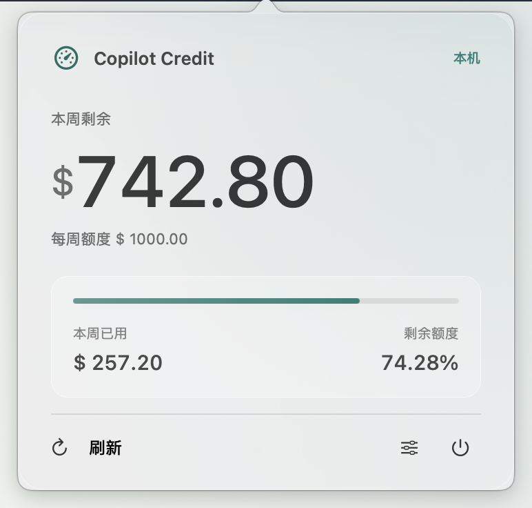
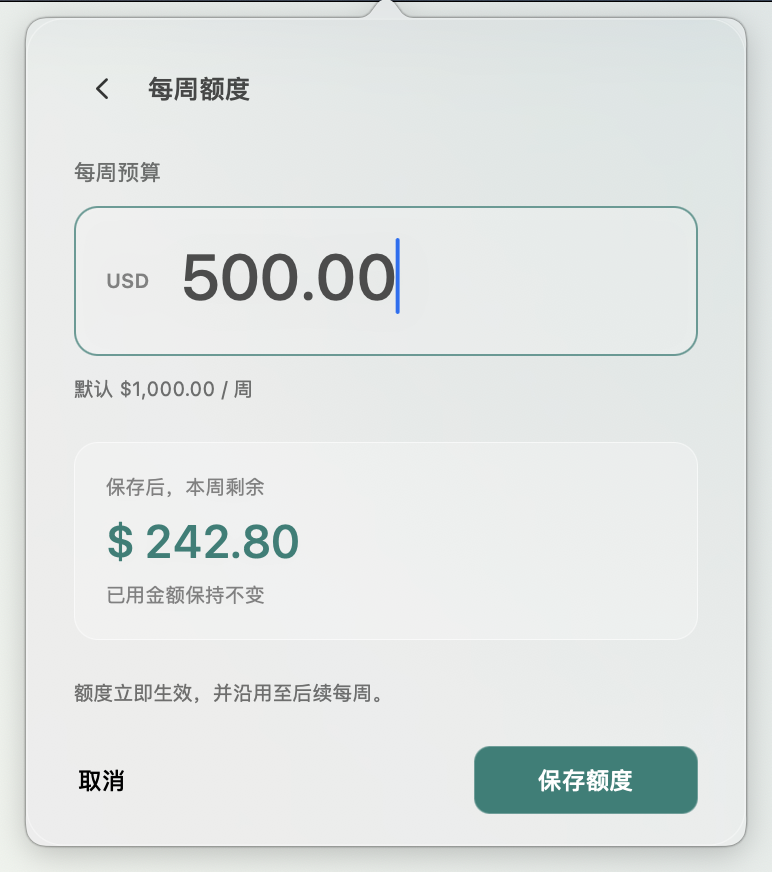

<div align="center">

# Copilot Credit Monitor

**Your weekly Copilot budget, one click away.**

A small, native macOS menu bar app. See what's left, adjust your budget, and get back to work.

**macOS 13+ · Swift 6 · AppKit · Local-only**

</div>

<table>
  <tr>
    <th>Weekly balance</th>
    <th>Budget settings</th>
  </tr>
  <tr>
    <td valign="top"></td>
    <td valign="top"></td>
  </tr>
</table>

<p align="center"><sub>Actual app screenshots, captured with synthetic data against a neutral backdrop. The current interface is in Simplified Chinese.</sub></p>

> **A local budget monitor, not a GitHub account balance.**
> Amounts come from compatible Copilot CLI / SDK logs on your Mac. They do not include
> other devices, GitHub web usage, or native IDE Chat.

## A little utility, not another dashboard

- **One-click overview.** Remaining dollars, spending, and remaining percentage.
  No Dock icon, persistent main window, or stream of diagnostic text.
- **Native Frost interface.** Translucent system material, fine borders, SF Symbols,
  light/dark appearance support, and restrained spring interactions that respect Reduce Motion.
- **Your weekly budget.** Start at **$1,000/week** or choose another amount.
  Preview the result before saving; changes apply immediately without clearing spending.
- **Updates as you work.** File watching, bounded parallel scanning, saved read positions,
  and manual refresh—without a once-per-second polling loop.
- **Honest about missing data.** Incomplete usage is shown as a bound, not an exact balance.
  Read failures remain visible instead of making the full budget appear available.
- **Stays on your Mac.** No app login, telemetry, cloud sync, or third-party dependencies.

## Build and open

You need **macOS 13 or later** and an Xcode toolchain with **Swift 6.0 or later**
selected for command-line use.

```bash
git clone https://github.com/PetrGuan/CopilotCreditMonitor.git
cd CopilotCreditMonitor
bash scripts/build-app.sh
open dist/CopilotCreditMonitor.app
```

The script builds a release executable, creates an `.app` bundle, and applies a local
ad-hoc signature. It does **not** run tests or launch the app.

This is an early, source-built application—not a notarized distribution.
The build targets your Mac's architecture; the current implementation has been built
and run locally on Apple Silicon.

## Using the app

1. Click the **gauge icon** in the menu bar to see this week's balance.
2. Open the **sliders button** to edit your weekly budget in USD.
3. Enter an amount, review the preview, and choose **保存额度** (Save budget).
4. Use **刷新** (Refresh) for a manual scan, or the **power button** to quit.

Budget settings persist across launches and continue into subsequent weeks.
For example, if you've used **$257.20**, changing the weekly budget from **$1,000**
to **$500** immediately changes the remaining amount to **$242.80**.
Nothing is removed from the usage history.

## What the numbers mean

| Rule | Behavior |
| --- | --- |
| Default budget | $1,000.00 per week; editable in the app |
| Dollar conversion | 100 credits = $1 |
| Reported unit | 1 credit = 1,000,000,000 nano AI units |
| Weekly boundary | Monday at 01:00 Beijing time, fixed UTC+8 |
| Over budget | Remaining dollars can be negative |
| Partial or unavailable usage | Known spending is a lower bound; remaining budget is an upper bound (`≤`) |
| BYOK requests | Excluded from the Copilot-credit budget |

The budget and conversion are **project rules**, not a promise of GitHub entitlements,
official pricing, or an invoice. The app reads reported credit amounts—it does not
estimate dollars from token counts or interpret `usage.cost` as money.

## Local data and privacy

By default, the app reads:

```text
~/.copilot/session-state/*/events.jsonl
```

Its own state is stored in:

```text
~/Library/Application Support/CopilotCreditMonitor/
├── ledger-v1.json      # Usage entries, source paths, read positions, parser revision
├── settings-v1.json    # Weekly budget in cents
└── monitor.lock        # Prevents concurrent writers to the same data directory
```

Reading a mixed session log necessarily reads bytes that may contain conversations.
The monitor extracts accounting fields, **not prompts, responses, or tool contents**,
and does not transmit the logs. Request identifiers are hashed for deduplication.

Do not delete or edit the ledger to change your budget—use the settings page.
Back up local data before attempting manual recovery.

### A different session directory

Launch the executable directly to override the source directory. Use a separate data
directory when switching profiles so their histories remain isolated:

```bash
./dist/CopilotCreditMonitor.app/Contents/MacOS/CopilotCreditMonitor \
  --session-dir "$HOME/path/to/profile/session-state" \
  --data-dir "$HOME/Library/Application Support/CopilotCreditMonitor-Profile"
```

`--session-dir` replaces the default source. `--data-dir` isolates the ledger,
budget settings, and instance lock together.

<details>
<summary><strong>How scanning works—and why the first import takes longer</strong></summary>

The first import may read historical log bytes to attribute usage by event time.
It shows progress rather than pretending the full budget is unused.

- A dedicated scan queue uses **three file workers** by default, bounded to 2–4.
  Each worker owns its parser; results are merged deterministically.
- JSONL is read in chunks with per-record and per-chunk cleanup. A scan stops at
  its file-size snapshot rather than chasing an actively growing file indefinitely.
- The parser recognizes `session.usage_record` and the fields
  `data.usage.aiCreditsStatus`, `data.usage.isByok`, `data.usage.apiCallId`, and
  `data.usage.copilotUsage.totalNanoAiu`.
- Saved read positions make subsequent scans incremental; unchanged files skip read I/O.
- Duplicate request IDs are deduplicated, and later complete records can replace
  earlier partial reports.
- An unfinished final JSONL line waits for its newline. Complete records larger
  than **64 MiB**, invalid usage records, and damaged local history produce explicit errors.
- Parse failure aborts the scan transaction rather than committing a misleading
  partial total. Parser revisions can trigger a one-time replay of existing logs.

Client log formats are not a stable billing API. Missing or deleted source logs,
unsupported clients, and unreported usage limit coverage even when a scan succeeds.

</details>

## Development

| Location | Purpose |
| --- | --- |
| `Sources/CreditMonitorCore/` | Credit parsing, budget calculations, scanning, and persistence |
| `Sources/CopilotCreditMonitor/` | AppKit lifecycle, menu bar UI, Frost controls, and settings |
| `Tests/CreditMonitorCoreTests/` | Synthetic unit-test fixtures |
| `scripts/build-app.sh` | Local release build and `.app` packaging |
| `docs/screenshots/` | Current app screenshots using sample data |

Build and bundle inspection commands:

```bash
swift build
bash scripts/build-app.sh
plutil -lint dist/CopilotCreditMonitor.app/Contents/Info.plist
codesign --verify --strict dist/CopilotCreditMonitor.app
```

Tests are run manually. No UI-test target or GitHub Actions workflow is included.

Earlier [appearance studies](docs/design/frost-appearances.png) and
[budget-flow mockups](docs/design/frost-budget-settings.png) remain as design references;
the screenshots at the top show the current implementation.
